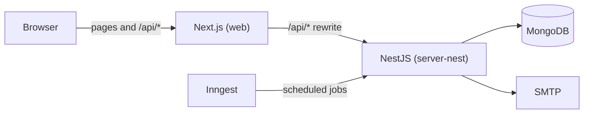
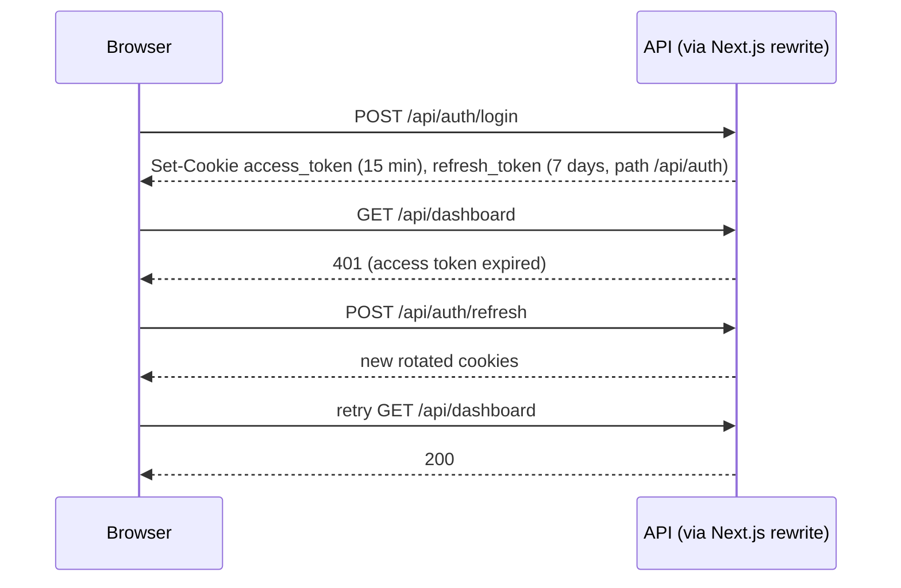

# Employee Management System


A full-stack HR portal with separate **Admin** and **Employee** experiences: employees, attendance, leave approvals, payslips and analytics.

Live demo: [<web URL>](https://employee-management-system-rust-seven.vercel.app/login)

<!-- Add 3-4 screenshots here: docs/screenshots/dashboard.png, employees.png, attendance.png, mobile.png -->

## Why this project

This is a rebuild of an earlier JavaScript MERN app. The goal was to move it to a production-style architecture: typed end to end, secure session handling, validated APIs, automated tests and CI. The original version is preserved under the [`development`](https://github.com/Mahmoud-Aldeeb/Employee-management-system/tree/development) tag.

## Features

- **Role-based portals:** admin and employee, enforced in the UI and again by the API
- **Employees:** create, edit and soft-delete with a linked login account, department filter, search, CSV export
- **Attendance:** clock in/out with Africa/Cairo day boundaries, table and calendar views, working-hours stats
- **Leave:** requests with validation, admin approval workflow, history and balances per type
- **Payslips:** generated per month with the net salary calculated on the server, printable view, owner-only access
- **Analytics:** attendance trend, leave breakdown, working hours and department activity
- **Background jobs (Inngest):** automatic check-out, pending-leave reminders, daily attendance reminders by email
- **Responsive:** tested on desktop and mobile viewports

## Tech stack

| Area         | Technology                                                                                                                        |
| ------------ | --------------------------------------------------------------------------------------------------------------------------------- |
| Frontend     | Next.js 16 (App Router, Cache Components), React 19, TypeScript, Tailwind CSS v4, TanStack Query, React Hook Form + Zod, Recharts |
| Backend      | NestJS 12, TypeScript, Mongoose / MongoDB, Passport JWT, class-validator, Helmet, express-rate-limit                              |
| Auth         | httpOnly cookies: short-lived access token + rotating refresh token                                                               |
| Jobs / email | Inngest, Nodemailer                                                                                                               |
| Testing      | Vitest, Testing Library, MSW, Supertest, Playwright                                                                               |
| CI/CD        | GitHub Actions, Vercel                                                                                                            |

## Architecture



The browser only talks to the Next.js origin. `/api/*` is proxied to the NestJS API, so cookies are first-party and no CORS configuration is needed.

### Authentication flow



## Engineering decisions

- **No tokens in `localStorage`.** Sessions live in httpOnly cookies. Refresh tokens are stored hashed, rotated on every use and revoked on logout and password change.
- **Server-side authority.** Net salary is calculated by the API, payslips are only readable by their owner or an admin, and request bodies are validated with DTOs that reject unknown fields.
- **Transactions.** Creating an employee creates the user and the employee record atomically.
- **Time zones.** Attendance days and "late" thresholds are computed in Africa/Cairo on the server, independent of the client clock.
- **Server state with TanStack Query.** Every mutation invalidates the affected data, so pages stay consistent without manual refetching.
- **Rate limiting.** Login attempts are limited per email. `@nestjs/throttler` was replaced with `express-rate-limit` because Nest 12 is ESM-only and the CommonJS throttler could not be loaded by the Vercel function runtime.
- **Tests at every level.** Component tests with mocked network (MSW), API tests against an in-memory MongoDB replica set, and end-to-end tests against the real stack.

## Testing

| Level              | Tooling                                                        | Run                                  |
| ------------------ | -------------------------------------------------------------- | ------------------------------------ |
| API integration    | Vitest, Supertest, in-memory MongoDB replica set               | `cd server-nest && npm run test:e2e` |
| Unit and component | Vitest, Testing Library, MSW                                   | `cd web && npm test`                 |
| End to end         | Playwright (desktop and mobile), full stack on throwaway ports | `cd web && npm run e2e`              |

GitHub Actions runs lint, type-check, unit tests, build and the end-to-end suite on every pull request.

## Getting started

Requirements: Node.js 22 and a MongoDB database (transactions need a replica set; MongoDB Atlas works).

```bash
# API
cd server-nest
cp .env.example .env        # fill in the values
npm install
npm run seed                # creates the admin from ADMIN_EMAIL / ADMIN_PASSWORD
npm run start:dev

# Web (second terminal)
cd web
cp .env.example .env.local  # API_URL=http://localhost:4000
npm install
npm run dev
```

Open http://localhost:3000.

### Environment variables

| App         | Variable                                                           | Purpose                                      |
| ----------- | ------------------------------------------------------------------ | -------------------------------------------- |
| server-nest | `MONGODB_URL`                                                      | MongoDB connection string                    |
| server-nest | `JWT_SECRET`, `JWT_REFRESH_SECRET`                                 | Token signing secrets (32+ characters)       |
| server-nest | `CLIENT_URL`                                                       | Frontend origin                              |
| server-nest | `SMTP_HOST`, `SMTP_PORT`, `SMTP_USER`, `SMTP_PASS`, `SENDER_EMAIL` | Email delivery                               |
| server-nest | `ADMIN_EMAIL`, `ADMIN_PASSWORD`                                    | Seed script and admin reminders              |
| server-nest | `INNGEST_EVENT_KEY`, `INNGEST_SIGNING_KEY`                         | Background jobs                              |
| web         | `API_URL`                                                          | NestJS API origin used by the `/api` rewrite |

## Repository structure

```text
web/            Next.js frontend, component tests and Playwright tests
server-nest/    NestJS API and integration tests
.github/        CI workflows
```

See [`web/README.md`](web/README.md) and [`server-nest/README.md`](server-nest/README.md) for details on each app.

## Roadmap

- Leave balances and a team calendar
- Audit log of sensitive changes
- In-app notifications
- Password reset and first-login password change
- Arabic / RTL interface
