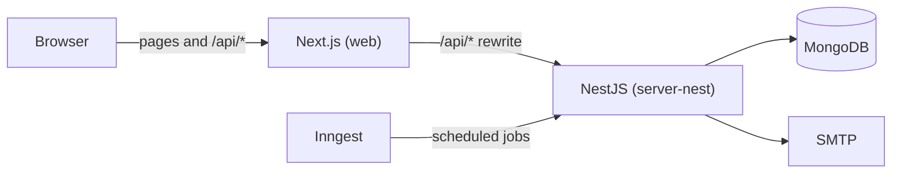
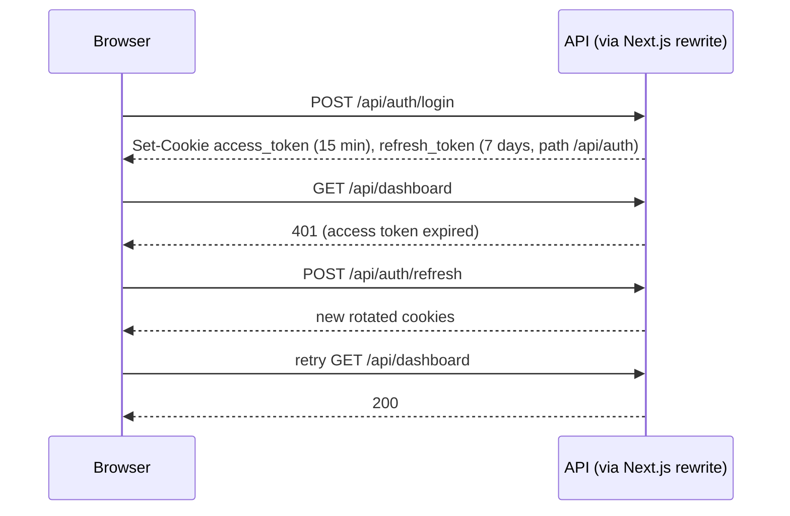

# Employee Management System

[](https://github.com/Mahmoud-Aldeeb/Employee-management-system/actions/workflows/server-ci.yml)
[](https://github.com/Mahmoud-Aldeeb/Employee-management-system/actions/workflows/web-ci.yml)
[](https://employee-management-system-rust-seven.vercel.app/login)

A full-stack HR portal with separate **Admin** and **Employee** experiences: employees, attendance, leave approvals, payslips and analytics.

### Built With

[](https://skillicons.dev)


🔗 **[Open Live Demo](https://employee-management-system-rust-seven.vercel.app/login)**

## Why this project

This is a rebuild of an earlier JavaScript MERN app. The goal was to move it to a production-style architecture: typed end to end, secure session handling, validated APIs, automated tests and CI. The original version is preserved under the [`legacy-mern-js`](https://github.com/Mahmoud-Aldeeb/Employee-management-system/tree/legacy-mern-js) tag.

## Features

- **Role-based portals:** admin and employee, enforced in the UI and again by the API
- **Employees:** create, edit and soft-delete with a linked login account, department filter, search, CSV export
- **Attendance:** clock in/out with Africa/Cairo day boundaries, table and calendar views, working-hours stats
- **Leave:** requests with validation, admin approval workflow, history and balances per type
- **Payslips:** generated per month with the net salary calculated on the server, printable view, owner-only access
- **Analytics:** attendance trend, leave breakdown, working hours and department activity
- **Background jobs (Inngest):** automatic check-out, pending-leave reminders, daily attendance reminders by email
- **Responsive:** tested on desktop and mobile viewports
- **Team calendar:** a month view of who is out, with department filter for admins; employees see their own requests and the approved leave of their department without its type

- **Dashboard:** one page that adapts to the role. Admins get KPIs, pending leave requests they can approve or reject in place, who is out today, a 7-day attendance trend and a department breakdown; employees get clock in/out, their current salary, leave balance and latest payslip
- **Audit log:** every administrative action (employee and salary changes, leave decisions, payslips, admin sign-ins, password changes) is recorded with the values before and after, saved in the same transaction as the change and never containing a password or secret; searchable, filterable and paginated, and kept for 180 days
- **Demo mode:** one-click "Explore as Admin / Employee" with realistic data that resets every night

## Tech stack

| Area         | Technology                                                                                                                        |
| ------------ | --------------------------------------------------------------------------------------------------------------------------------- |
| Frontend     | Next.js 16 (App Router, Cache Components), React 19, TypeScript, Tailwind CSS v4, TanStack Query, React Hook Form + Zod, Recharts |
| Backend      | NestJS 12, TypeScript, Mongoose / MongoDB, Passport JWT, class-validator, Helmet, express-rate-limit                              |
| Auth         | httpOnly cookies: short-lived access token + rotating refresh token                                                               |
| Jobs / email | Inngest, Nodemailer                                                                                                               |
| Testing      | Vitest, Testing Library, MSW, Supertest, Playwright                                                                               |
| CI/CD        | GitHub Actions, Vercel                                                                                                            |

## Architecture



The browser only talks to the Next.js origin. `/api/*` is proxied to the NestJS API, so cookies are first-party and no CORS configuration is needed.

### Authentication flow



## Engineering decisions

- **No tokens in `localStorage`.** Sessions live in httpOnly cookies. Refresh tokens are stored hashed, rotated on every use and revoked on logout and password change.
- **Server-side authority.** Net salary is calculated by the API, payslips are only readable by their owner or an admin, and request bodies are validated with DTOs that reject unknown fields.
- **Transactions.** Creating or updating an employee changes the user, the employee record and the salary atomically, and every audited change (including leave decisions and payslips) is saved in the same transaction as its audit entry, so there is never a change without a record or a record without a change.
- **Time zones.** Attendance days and "late" thresholds are computed in Africa/Cairo on the server, independent of the client clock.
- **Server state with TanStack Query.** Every mutation invalidates the affected data, so pages stay consistent without manual refetching.
- **Rate limiting.** Login attempts are limited per email. `@nestjs/throttler` was replaced with `express-rate-limit` because Nest 12 is ESM-only and the CommonJS throttler could not be loaded by the Vercel function runtime.
- **Tests at every level.** Component tests with mocked network (MSW), API tests against an in-memory MongoDB replica set, and end-to-end tests against the real stack.

## Testing

| Level              | Tooling                                                        | Run                                  |
| ------------------ | -------------------------------------------------------------- | ------------------------------------ |
| API integration    | Vitest, Supertest, in-memory MongoDB replica set               | `cd server-nest && npm run test:e2e` |
| Unit and component | Vitest, Testing Library, MSW                                   | `cd web && npm test`                 |
| End to end         | Playwright (desktop and mobile), full stack on throwaway ports | `cd web && npm run e2e`              |

GitHub Actions runs lint, type-check, unit tests, build and the end-to-end suite on every pull request.

## Getting started

Requirements: Node.js 24 and a MongoDB database (transactions need a replica set; MongoDB Atlas works).

```bash
# API
cd server-nest
cp .env.example .env        # fill in the values
npm install
npm run seed                # creates the admin from ADMIN_EMAIL / ADMIN_PASSWORD
npm run start:dev

# Web (second terminal)
cd web
cp .env.example .env.local  # API_URL=http://localhost:4000
npm install
npm run dev
```

Open http://localhost:3000.

## Live demo and API docs

- **Try it without signing up:** the login page has "Explore as Admin" and "Explore as Employee" buttons (enabled with `DEMO_MODE=true`). The demo uses sample data that is rebuilt every night, never emails demo addresses and never sends reminder emails and only touches accounts on the reserved `demo.example.com` domain.
- **API documentation (Swagger UI):** `/api/docs` on the API origin. Sign in from the page itself or use the demo login, and the browser session authorizes the "Try it out" requests.
- **Health check:** `GET /api/health` returns the service and database status (HTTP 503 when the database is unreachable).

## Run everything with Docker

```bash
docker compose up --build
```

Open http://localhost:3000 and use the demo buttons. MongoDB runs as a single-node replica set (required for transactions). To create a real admin: `docker compose exec api node dist/seed.js`.

### Environment variables

| App         | Variable                                                           | Purpose                                                                                                                                           |
| ----------- | ------------------------------------------------------------------ | ------------------------------------------------------------------------------------------------------------------------------------------------- |
| server-nest | `MONGODB_URL`                                                      | MongoDB connection string                                                                                                                         |
| server-nest | `JWT_SECRET`, `JWT_REFRESH_SECRET`                                 | Token signing secrets (32+ characters)                                                                                                            |
| server-nest | `CLIENT_URL`                                                       | Frontend origin                                                                                                                                   |
| server-nest | `SMTP_HOST`, `SMTP_PORT`, `SMTP_USER`, `SMTP_PASS`, `SENDER_EMAIL` | Email delivery                                                                                                                                    |
| server-nest | `ADMIN_EMAIL`, `ADMIN_PASSWORD`                                    | Seed script and admin reminders                                                                                                                   |
| server-nest | `INNGEST_EVENT_KEY`, `INNGEST_SIGNING_KEY`                         | Background jobs                                                                                                                                   |
| web         | `API_URL`                                                          | NestJS API origin used by the `/api` rewrite                                                                                                      |
| server-nest | DEMO_MODE                                                          | Enables the demo accounts, nightly demo reset and disables outgoing email.                                                                        |
| server-nest | `DEMO_MODE`                                                        | Enables the demo accounts and the nightly demo reset, and turns off reminder emails; account emails (invitations, password resets) are still sent |

## Audit log

Admins open `/audit-log` to see who did what, to whom and when (Cairo time), with the old and new values of every changed field. Filters (event type, search, date range) and pagination run on the server through `GET /api/audit-logs`.

- Only administrative actions are recorded; passwords and secrets are never stored, because only an allow-list of fields is compared.
- Entries expire after 180 days (MongoDB TTL index).
- Demo visitors only see demo events, and the nightly reset clears them and restores a realistic history.

## Leave policy (Egyptian Labor Law No. 14 of 2025)

| Rule         | Implementation                                                                                                                                                              |
| ------------ | --------------------------------------------------------------------------------------------------------------------------------------------------------------------------- |
| Annual leave | 15 days in the first year, 21 days afterwards, 30 days after 10 years of service; available after 6 months of service                                                       |
| Casual leave | 7 days a year, at most 2 working days per request, deducted from the annual balance                                                                                         |
| Sick leave   | Tracked and not capped (pay is governed by social insurance)                                                                                                                |
| Working days | Sunday to Thursday; Friday and Saturday never consume leave                                                                                                                 |
| Booking      | Requests are refused when they overlap another request, exceed the balance or break a rule above; pending requests reserve days; reopening a rejected request is re-checked |

Simplifications: balances are calculated per calendar year without carry-over, public holidays are not excluded, and the age-50 and disability tiers are not modeled. All numbers live in `server-nest/src/leave/policy/leave-policy.ts`.

## Repository structure

```text
web/            Next.js frontend, component tests and Playwright tests
server-nest/    NestJS API and integration tests
.github/        CI workflows
```

See [`web/README.md`](web/README.md) and [`server-nest/README.md`](server-nest/README.md) for details on each app.

## Roadmap

- In-app notifications
- Password reset and first-login password change
- Attendance correction requests
- Arabic / RTL interface
